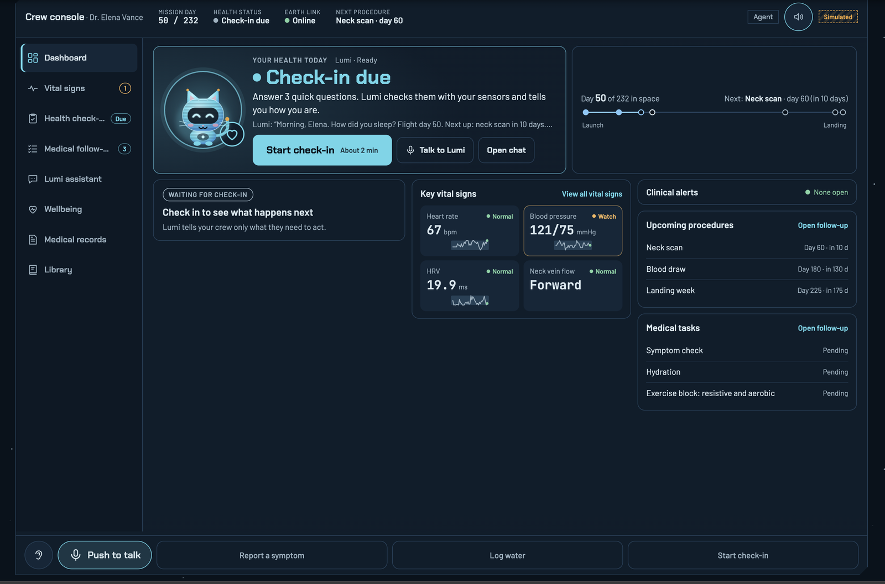
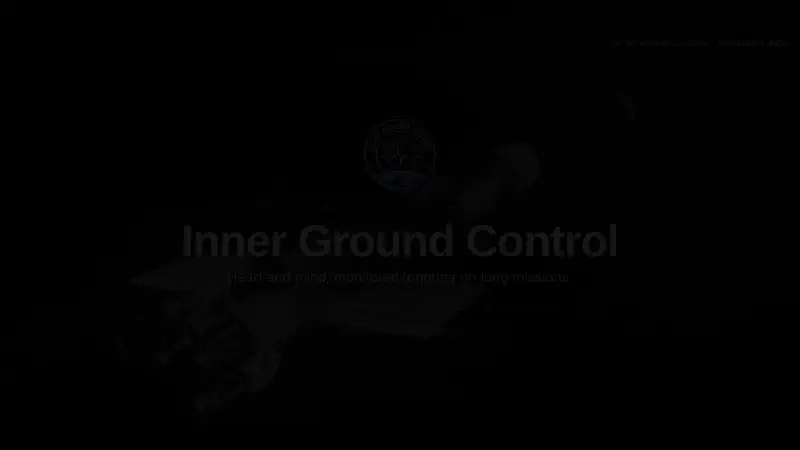

<div align="center">

# VesselWatch

**Ground control that travels with the crew.**<br>
An astronaut health companion for heart and mind on long missions, built by **Inner Ground Control** for NASA Space Apps 2026, Málaga.

<a href="https://vessel-watch.vercel.app/#/dashboard"></a>


<br><br>

<a href="https://vessel-watch.vercel.app/#/dashboard">
  
</a>

<sub>The crew console on mission day 50 of 232. All crew data is simulated. Click the image to open the live app.</sub>

### Watch the 30-second demo

<a href="docs/media/Inner_Ground_Control_30s.mp4">
  
</a>

<sub>Silent preview with English captions. AI-generated visuals, simulated data. Click it for the full video.</sub>

</div>

## Try it

**Live app:** [vessel-watch.vercel.app](https://vessel-watch.vercel.app/#/dashboard). It runs in the browser, with nothing to install.

- **Start check-in:** three quick questions; Lumi checks them against the sensors and tells you what happens next.
- **Talk to Lumi** or **Push to talk:** the same check-in by voice, hands-free.
- **Vital signs, Medical follow-up, Wellbeing:** what the medical agent sees, and who gets told what.

Voice works best in Chrome.

## About

An astronaut health companion for long missions, built for the NASA Space Apps Challenge. Lumi, a robot-cat companion, runs a short daily check-in or a voice-guided body scan. A transparent medical agent then decides what to do and who needs to know. It focuses on circulation and neck-vein clot risk in microgravity.

**Decision support, not diagnosis.** All crew data in the demo is simulated inside published ISS in-flight ranges by the HemoMind engine. The clot decision is NASA OCHMO-MTB-007 (2026) as a pure function, including its apixaban regimen. Other thresholds are demo values pending clinician review.

## Team

**Inner Ground Control**, NASA Space Apps 2026, Málaga.

| Who | Contribution |
|---|---|
| **Violeta** | Co-founded the mental-health side of the concept, and designed the smartwatch concept: how the crew is monitored continuously and when the watch asks for a check. |
| **Victor** | Co-founded the mental-health side of the concept, proposed basing the companion on a real health app, and built the dashboards. Co-led product refinement. |
| **Claudia** | Brought the circulation-health focus to the concept and shaped much of the product vision. Turned monitoring into a game the crew wants to play, created Lumi the companion avatar, and designed the AI medical agent, grounded in NASA's clot protocol (OCHMO-MTB-007) and published ISS in-flight medical data. Co-led product refinement. |
| **Demo** | Created the outstanding final presentation, with a clear vision for its story and visuals. |
| **Manuel** | Co-founded the mental-health side of the concept, and reviewed the presentation and the product to sharpen both. |

## Tech stack

**Front end:** HTML, CSS and vanilla JavaScript, with no framework · Web Speech API for voice<br>
**Medical agent:** JavaScript and Python engines sharing one JSON playbook, ready for a FastAPI backend<br>
**HemoMind engine:** TypeScript, tested with Vitest, compiled to one JS file<br>
**Quality:** GitHub Actions runs both agent engines against shared safety scenarios on every change<br>
**Hosting:** Vercel, with preview links on every pull request

## What's here

| Path | What it is |
|---|---|
| `index.html` | The app: crew console with Lumi, mission timeline, daily missions, body scan, voice control, and the medical agent panel |
| `engine/hemomind-core.js` | Generated HemoMind engine: telemetry stream and OCHMO-MTB-007 decision, the single source of truth (see `engine/README.md`) |
| `agent/playbook.json` | All clinical knowledge: rules, daily missions, NASA schedule, evidence sources, speech lexicon |
| `agent/agent.js` | The agent engine for browsers and Node |
| `agent/agent.py` | The same engine in Python, for a FastAPI backend |
| `agent/scenarios.json` | Test cases with expected results |
| `agent/README.md` | How the agent works and how to reuse it |

## Run it locally

The app loads the playbook with `fetch`, so open it through a local server, not by double-clicking the file:

```bash
python3 -m http.server 8000
# then open http://localhost:8000
```

## Test the agent

```bash
node agent/test.mjs
python3 agent/test_agent.py
```

Both engines must pass the same scenarios. Add a case to `agent/scenarios.json` for every rule change.

## Deploy

Connect this repo to Vercel as a static site, with no build step. Every push to `main` redeploys, and every pull request gets a preview link.

## Voice

Tap 👂, then say **"Lumi, activate check-in"** or **"Lumi, body scan"**. Anything else after "Lumi" goes to the medical agent. The same commands also work typed into the text box. A full spoken back-and-forth works in Chrome; inside claude.ai, Lumi answers on screen while it listens.

## Contributing

See [CONTRIBUTING.md](CONTRIBUTING.md).
